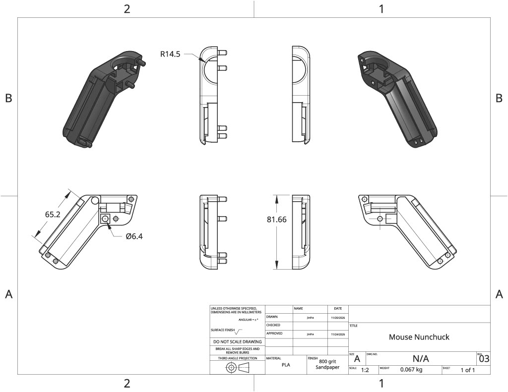
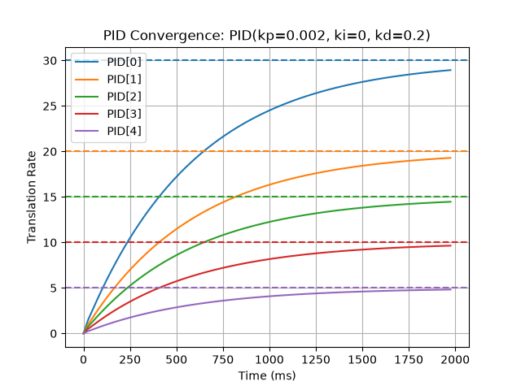

# Nunchuck-Mouse
A mouse alternative to make computer usage more accessible.

# Overview
**Problem:** The world continues to become more technologically reliant. Computers and much of computer software relies on the user to be able to use a mouse and keyboard limiting accessibility. Arm injuries such a fractures and dislocations are not uncommon. Notably through sports and play these types of injury are not uncommon. The NHA found that 1,130 upper extremity injuries per 100,000 persons per year were treated in the ER in 2009 [[1]](https://pmc.ncbi.nlm.nih.gov/articles/PMC3280373/). This poses a challenge for students following along in classes and employees trying to return to office work.

**Mission Statement:** To improve computer accessibility for individuals with restricted arm movement by developing a computer mouse alternative.

# Design

# CAD
The electronics needed to be neatly housed in an ergonomic housing that could fit electronics in a way that supports easy installation and repair and can be manufactured with ease. The housing could be split into halves with alignment pins with open space inside for electronics. The design originates from inspiration from a [Wii Nunchuck](https://www.nintendo.com/en-gb/Wii/Accessories/Accessories-Wii-Nintendo-UK-626430.html). The housing places the joystick by the thumb position with left and right click buttons for the pointer finger.

# Electronics

# Code
Additionally code is included to test PID rates before pushing software to the device. The PIDs smooth out the reaction to input to allow for small motions by flicking the joystick but increased speeds with sustained input. The figure below is the current PID convergence to a range of inputs (dashed lines). The rates are currently tuned to hit 50% of the input in ~0.3s and 80% in ~1s.

# Bill of Materials (BOM)

# Results
